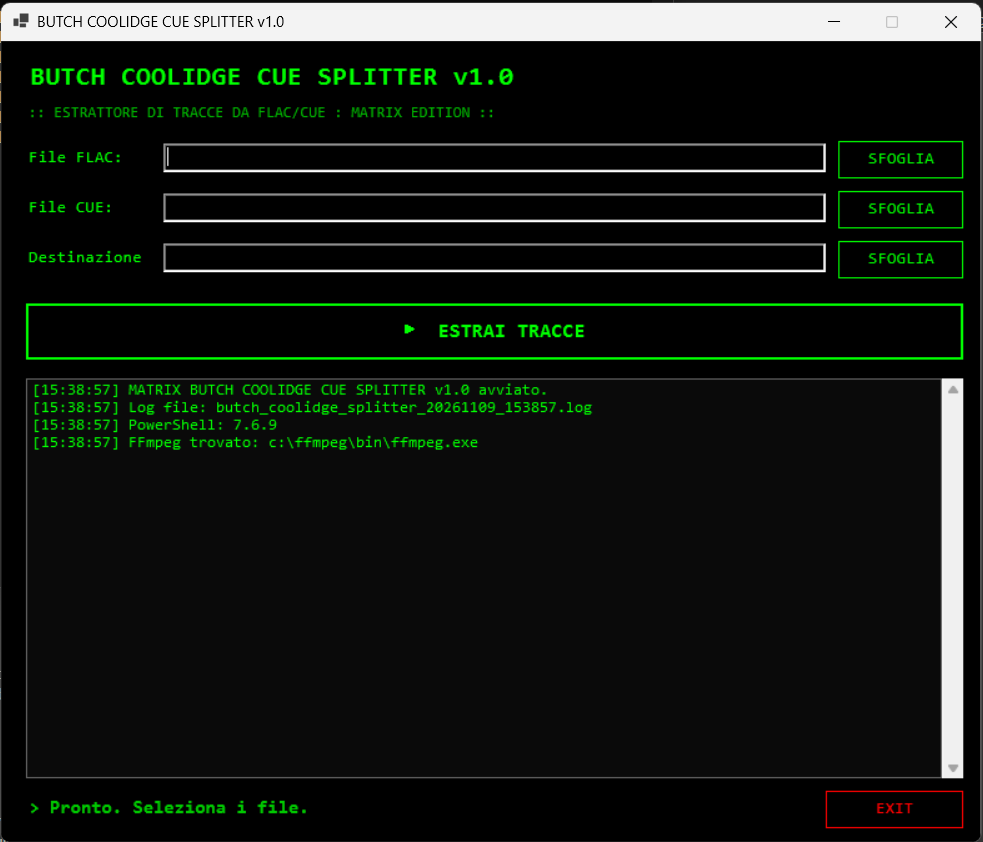

# 🎵 CUE Splitter

> **Codename: Butch Coolidge** — *"Il fixer per la tua musica."*

Estrattore di tracce audio da file immagine FLAC + CUE. 
Divide un album in un unico file nei singoli brani, preservando la qualità lossless e i metadati originali.

## ✨ Feature

- ✅ **Interfaccia Matrix**: sfondo nero, testo verde, font Consolas.
- ✅ **Parsing intelligente del CUE**: legge titoli, artisti e album dal file `.cue`.
- ✅ **Estrazione lossless**: i file sono FLAC, quindi la qualità rimane identica all'originale.
- ✅ **Durata corretta**: ogni traccia ha l'intestazione con la durata esatta (niente bug del "file da 41 minuti").
- ✅ **Metadati applicati**: Titolo, Artista, Album e Numero traccia vengono scritti nei file estratti.
- ✅ **Auto-apertura**: alla fine dell'estrazione, la cartella di destinazione si apre in Esplora File.
- ✅ **Log a schermo e su file**: per tenere traccia di ogni operazione.

## 📋 Requisiti

- **Windows 10 / 11**
- **PowerShell 7.2+** (scarica da https://aka.ms/powershell)
- **FFmpeg** (per la decodifica e la codifica audio)
  - Installa con: `winget install Gyan.FFmpeg`

## 🚀 Quick start

1. Clona il repo o scarica lo ZIP.
2. Fai doppio click su `avvia.bat`.
3. Seleziona il file **FLAC** (l'album intero).
4. Seleziona il file **CUE** (la "mappa" delle tracce).
5. Scegli la cartella di destinazione.
6. Clicca **ESTRAI TRACCE**.

## 🎯 Casi d'uso

- Dividere un album FLAC+CUE in singoli brani da mettere sul telefono o sull'autoradio.
- Aggiungere i metadati corretti a un album estratto da CD.
- Preparare la propria libreria musicale per software come MusicBee, Foobar2000 o Plex.

## ⚠️ Attenzione

- Il tool usa FFmpeg per **ricodificare** in FLAC (non `-c copy`), perché è l'unico modo per correggere l'intestazione della durata. Tuttavia, essendo FLAC un formato lossless, **la qualità audio rimane identica** all'originale.
- Per velocizzare l'estrazione, il tool usa `-compression_level 0` (compressione minima). I file saranno leggermente più grandi, ma la velocità sarà molto maggiore.
- Il tool richiede un file `.cue` valido. Se il file CUE è danneggiato o non contiene le informazioni sulle tracce, l'estrazione potrebbe fallire.

## 📝 Changelog

### [1.0.0] - 2026-11-09
#### Aggiunto
- GUI Matrix per la selezione dei file FLAC/CUE.
- Parser del file CUE per estrarre titoli, artisti e tempi di inizio.
- Estrazione delle tracce con FFmpeg (ricodifica FLAC lossless).
- Correzione automatica della durata dell'ultima traccia.
- Applicazione dei metadati ID3 (Titolo, Artista, Album, Traccia).
- Log a schermo e su file.
- Auto-apertura della cartella di destinazione.

## 📜 Licenza

MIT (vedi LICENSE).

## 🙏 Crediti

- Sviluppato con PowerShell 7 + WinForms + FFmpeg.
- Fabry Toolbox.
